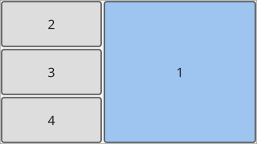
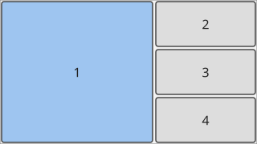
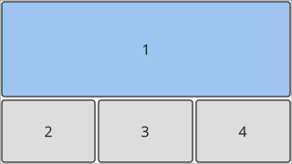
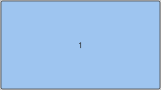
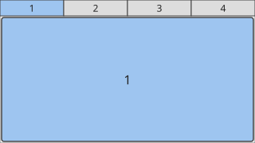
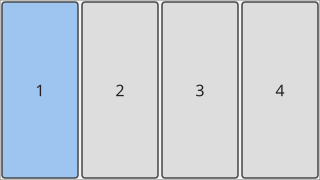
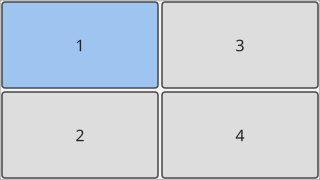
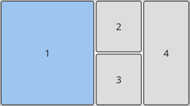
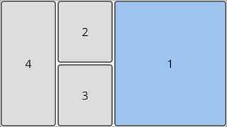
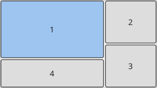

= Keybindings
:toc: left
:toclevels: 2

These are oxmonad's default bindings. They are defined in
link:../crates/oxmonad-core/default-config.toml[`crates/oxmonad-core/default-config.toml`],
the single source of defaults; override, add or remove (`= "none"`) bindings in
the `[keybindings]` and `[pointer_bindings]` tables of your
`~/.config/oxmonad/config.toml`, which also lists every available action.

Bindings are written as `Mod+Shift+j`: key names are xkb keysym names
(`Return`, `comma`, `XF86AudioPlay`, …) and *`Mod`* is the `modifier`
setting, *Super* (the logo key) by default — set `modifier = "Alt"` to use
xmonad's classic `mod1Mask`. The tables below assume Super.

== Launching programs

[cols="1,2",options="header"]
|===
|Shortcut |Action
|`Super` + `Shift` + `Return` |Spawn the terminal (`alacritty`)
|`Super` + `p` |Open the application launcher (`tofi-run`, styled like the old `dmenu_run`)
|`Super` + `Shift` + `l` |Lock the screen like slock (`oxmonad-lock`: black, blue while typing, red on a wrong password; waylock if installed, else swaylock)
|===

== Focus & window movement

[cols="1,2",options="header"]
|===
|Shortcut |Action
|`Super` + `j` |Focus the next window in tiling order
|`Super` + `k` |Focus the previous window in tiling order
|`Super` + `Shift` + `j` |Swap the focused window with the next (wrapping)
|`Super` + `Shift` + `k` |Swap the focused window with the previous (wrapping)
|`Super` + `Return` |Swap the focused window with the master window
|`Super` + `t` |Sink a floating window back into the tiling
|`Super` + `Shift` + `c` |Close the focused window
|`Super` + `o` |Move the focused window to the next monitor (follows)
|`Super` + `f` |Toggle fullscreen for the focused window
|`Super` + `++`++` |Show / hide the `term` scratchpad (spawns it if needed)
|===

== Mouse

[cols="1,2",options="header"]
|===
|Binding |Action
|`Super` + left drag |Float the window under the pointer and move it
|`Super` + right drag |Float the window under the pointer and resize it
|Click a window |Focus it
|Click a workspace in the bar |View that workspace
|Click a tab |Focus that window
|Click a layout in the layout picker |Switch to that layout
|Click the key binding help |Close it
|Left click a tray icon |Activate the application (open its menu if the
item is only a menu)
|Middle click a tray icon |The application's secondary action
|Right click a tray icon |Open its menu (or ask the application to show its
own)
|Scroll over a tray icon |Pass the scrolling to the application
|===

"Click" means the left button. In an open tray menu, hovering highlights an
entry and a click chooses it or opens its submenu (to the side); `j`/`k`,
`Up`/`Down` and `Tab` move, `Return`/`space` choose, `Right`/`l` open a
submenu, `Left`/`h` close it and `Escape` closes a submenu or the menu.
Clicking anywhere else (a window, the bar, the icon again) or a key binding
closes the menu.

Focus follows the mouse (`focus_follows_mouse = true`, xmonad's default):
moving the pointer onto a window focuses it. Windows that ask to be moved or
resized (dragging a client-side title bar) float, like xmonad's `mod+drag`.

== Layouts & resizing

The layout ring matches the xmonad config. The bar shows these names; the
pictures are generated from the layout code itself (regenerate with
`OXMONAD_BLESS=1 cargo test -p oxmonad-core --test layout_svgs`):

[cols="2,3,4,3",options="header"]
|===
|Layout |Example (4 windows, 1 = master) |Arrangement |xmonad equivalent
|Tall Right | |master column on the right, stack on the left |`reflectHoriz ResizableTall`
|Tall | |master column on the left, stack on the right |`ResizableTall`
|Wide | |master row on top, stack below |`Mirror ResizableTall`
|Full | |focused window fills the screen, no borders |`noBorders Full`
|Tabs | |focused window below a tab strip |`tabbed`
|Grid Rows | |grid filled row by row (a single row of columns until there are many windows) |`Mirror Grid`
|Grid | |grid filled column by column |`Grid`
|Three Columns | |wide master column on the left, stack split over two columns |`ThreeCol`
|Three Columns Right | |mirror image of Three Columns |`reflectHoriz ThreeCol`
|Corner | |master in the top-left corner (⅔ × ⅔), the others in an L around it: a column down the right edge and a row below the master (split 3 : 2; five windows make a 3 × 3 grid). `Mod+h`/`Mod+l` change the master's width, `Mod+Up`/`Mod+Down` its height |none (oxmonad only)
|===

Each workspace cycles independently and each layout keeps its own state.

The table shows the default ring order. The top-level `layouts` setting in
`config.toml` changes it: list layout names (the first column, ignoring
case) in the order `Super` + `Space` cycles through them and the layout
picker shows them. The first one is every workspace's default layout and
what a reset returns to; a layout left out is not in the ring. Unknown or
repeated names and an empty list are config errors.

[source,toml]
----
# Must come before the first [table] of the file.
layouts = ["Tall", "Full", "Tabs", "Grid"]
----

A reload applies a changed list to every workspace, keeping each one's
active layout when it is still listed (otherwise the workspace starts at
the first one); an unchanged list keeps every layout's state. A restart
behaves the same way.

[cols="1,2",options="header"]
|===
|Shortcut |Action
|`Super` + `Space` |Next layout
|`Super` + `Shift` + `Space` |Reset this workspace's layouts to the default
|`Super` + `Ctrl` + `Space` |Layout picker: pictures of every layout to choose from
|`Super` + `h` |Shrink the master area (narrower)
|`Super` + `l` |Expand the master area (wider)
|`Super` + `Up` |Expand the focused window vertically
|`Super` + `Down` |Shrink the focused window vertically
|`Super` + `,` |More windows in the master area
|`Super` + `.` |Fewer windows in the master area
|===

The layout picker shows the pictures above with the layout names, the
current layout outlined and the selection highlighted (starting on the
current layout). `j`/`k` (or the arrow keys, `Tab`/`Shift`+`Tab`) move the
selection, wrapping; `Return` (or `Space`) applies it, `1`..`9`/`0` apply the
first to tenth layout directly, the pointer highlights the picture under it
and a click applies that layout, and
`Escape` or `Super` + `Ctrl` + `Space` close the picker unchanged.

== Workspaces

[cols="1,2",options="header"]
|===
|Shortcut |Action
|`Super` + `1`..`9` |View that workspace on the active monitor
|`Super` + `Shift` + `1`..`9` |Move the focused window to that workspace
|`Super` + `Shift` + `z` |Toggle back to the most recently hidden workspace
|`Super` + `v` |Prompt: view a workspace by name (creates it)
|`Super` + `m` |Prompt: move the focused window to a workspace (creates it)
|`Super` + `Shift` + `m` |Prompt: copy the focused window to a workspace
|`Super` + `Shift` + `r` |Prompt: rename the current workspace
|`Super` + `Shift` + `BackSpace` |Remove the current workspace (windows merge into the previous one)
|===

Inside a prompt: type to filter, `Tab`/`Shift`+`Tab` cycle the completions,
`Return` confirms (the highlighted completion, or the typed name), `Escape`
cancels. Editing follows `XMonad.Prompt`: `Left`/`Right`/`Home`/`End`,
`BackSpace`/`Delete`, `Ctrl`+`w` (delete word), `Ctrl`+`k` / `Ctrl`+`u` (kill
to end / start), `Ctrl`+`a` / `Ctrl`+`e`, `Ctrl`+`g` (cancel).

== Screens (multi-monitor)

Physical screens are ordered top-to-bottom, then left-to-right. A split
monitor counts as several screens (its virtual screens, left to right).

[cols="1,2",options="header"]
|===
|Shortcut |Action
|`Super` + `Right` / `Left` |Focus the next / previous screen
|`Super` + `Shift` + `Right`/`Left` |Send the focused window to the next / previous screen (focus stays)
|`Super` + `z` |Swap the visible workspaces of this screen and the next
|`Super` + `Shift` + `s` |Split this screen into two virtual screens side by side (`layoutSplitScreen 2 (TwoPane 0.5 0.5)`): it keeps its workspace on the left half, the right half shows the most recently hidden workspace
|`Super` + `Ctrl` + `Shift` + `s` |Rescreen: undo every split, one screen per monitor again (the current workspace stays; the other halves' workspaces become hidden)
|===

== Bar & session

[cols="1,2",options="header"]
|===
|Shortcut |Action
|`Super` + `b` |Show / hide the bar for this workspace (each workspace remembers it)
|`Super` + `n` |Refresh (retile all workspaces)
|`Super` + `q` |Restart in place: re-run the oxmonad binary (e.g. after a rebuild) and reload the configuration, keeping windows, workspaces and layouts
|`Super` + `Shift` + `q` |Quit: end the river session
|`Super` + `Shift` + `/` |Key binding help: every active binding, grouped
|===

The key binding help lists the bindings of your configuration (overrides and
removals included, `Mod` shown as the configured modifier) in sections, in
as many columns as fit the screen. `j`/`k` (or `Up`/`Down`),
`PageUp`/`PageDown` and `Home`/`End` scroll it when it does not fit;
`Escape`, `q`, `Return`, a click or `Super` + `Shift` + `/` close it.

== Notes

* Focus follows the monitor: focusing or clicking a window makes its monitor the
active one, so new windows and layout commands target that monitor.
* The focus, swap, and resize commands act on the *active monitor* only; each
monitor tiles its own windows independently.
* Zoom windows are managed automatically: the main/meeting windows tile (and
are pushed out of the master slot), every other Zoom window floats
(`manageZoomHook`).
* While the screen is locked only bindings without modifiers work (there are
none by default; e.g. media keys you add yourself).
