= oxmonad Tasks
:toc: left
:toclevels: 2

Open feature ideas, roughly in order of priority within each section.
Autostart / startup commands are deliberately out of scope: clients are
started by hand.

== Quick wins

* [ ] Finish xmonad's default bindings:
** `Mod+Tab` / `Mod+Shift+Tab`: focus the next / previous window.
** `Mod+w`/`e`/`r` and `Mod+Shift+w`/`e`/`r`: view / shift to physical
   screen 1/2/3.
** `Mod+Button2`: focus the window under the pointer and `shiftMaster` it.
* [ ] More bar interactions:
** Click the layout name or miniature to open the layout picker.
** Scroll over the workspace tags to switch workspaces.
* [ ] Configurable clock format and battery thresholds/colors (currently
  the xmobarrc values).

== Common xmonad-contrib features

* [ ] Per-workspace layout lists (`PerWorkspace` / `onWorkspace`), e.g.
  only `Tabs` and `Full` on a browser workspace; builds on the `layouts`
  key.
* [ ] Configurable layout parameters: master ratio, master count and
  resize step per layout instead of the standard values.
* [ ] Gaps between windows and at the screen edges (`Spacing`).
* [ ] Go to or bring a window by title (`WindowGo` / `WindowBringer`): a
  prompt over every window on every workspace, reusing the prompt's
  completion.
* [ ] Cycle through non-empty workspaces (`CycleWS`) and a deeper
  workspace history than `toggle-ws`.
* [ ] Sticky windows shown on every workspace (`copyToAll`), e.g. a
  picture-in-picture video.

== More layouts

Layouts from xmonad-contrib that oxmonad does not have yet, roughly in
order of usefulness. xmonad's own `Tall`, `Mirror Tall` and `Full`, and
contrib's `Tabbed`, `Grid`, `ThreeColumns` and `ResizableTile`, are already
built in (see link:keybindings.adoc#_layouts_resizing[`keybindings.adoc`]);
`OneBig` is close to `Corner`.

The pictures follow the built-in layout pictures: window `1` (blue) is the
master and focused unless noted otherwise. They are hand-drawn sketches in
`docs/layouts/ideas/`; once a layout is implemented, its picture is
generated from the real code like the others.

* [ ] *Three Columns Middle* (`ThreeColMid`, and `CenterMainFluid` for
  ultrawide screens): the master column in the middle of the screen, the
  stack split over a column on either side (alternating right, left). A
  single window stays centred instead of stretching over the whole width.
+
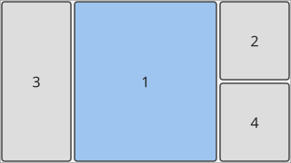

* [ ] *Spiral* (`Spiral`): each window takes half of the space the
  previous one left, turning clockwise into the centre (a Fibonacci
  spiral). The master gets half the screen; later windows get smaller.
+
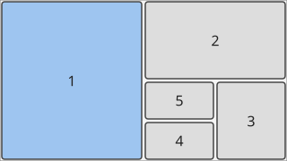

* [ ] *Dwindle* (`Dwindle`): like Spiral, but every split alternates
  between "right" and "down" without turning, so the small windows end up
  in the bottom-right corner (like Hyprland's `dwindle` layout).
+
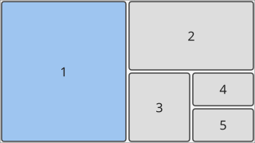

* [ ] *Binary Space Partition* (`BinarySpacePartition`): a manually
  arranged split tree. A new window splits the focused one; keys rotate,
  swap and resize splits and move a window to the other side of its
  parent split. The most flexible layout, but needs its own state and
  bindings, and the tree has to survive restarts.
+
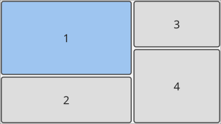

* [ ] *Centered Master* (`centerMaster`): the master floats centred over
  the screen, about ⅔ of its size, above the other windows, which are
  tiled underneath (here in columns). Good for one main window with
  reference windows peeking out around it.
+
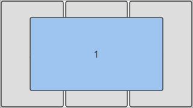

* [ ] *Centered If Single* (`CenteredIfSingle`): a modifier for any
  layout: a lone window is shrunk to a centred rectangle (e.g. 80 % × 80 %)
  instead of filling a wide screen; with two or more windows the
  underlying layout applies unchanged.
+
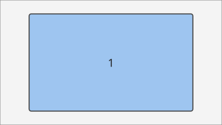

* [ ] *Two Pane* (`TwoPane`, `TwoPanePersistent`): the master on the
  left, the focused stack window on the right, every other window hidden.
  Focusing the next window swaps which one shows on the right.
+
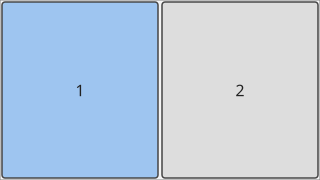

* [ ] *Multi Columns* (`MultiColumns`, and the newer `Columns`): columns
  that each hold a fixed number of windows, adding a new column when they
  are full (here one window in the first column, two in the others).
  `Columns` lets windows be moved between columns by hand instead.
+
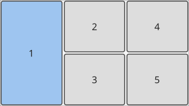

* [ ] *Accordion* (`Accordion`): every window spans the full width; the
  focused window gets nearly all the height and the others shrink to
  title-bar-sized strips above and below it (window `2` is focused here).
+
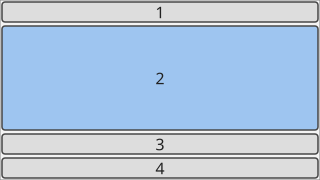

* [ ] *Dishes* (`Dishes`, `MultiDishes`, `StackTile`): the master on top,
  the other windows stacked below it as thin full-width "dishes" of a
  fixed height. `StackTile` makes the master area resizable. Mostly
  useful on small screens.
+
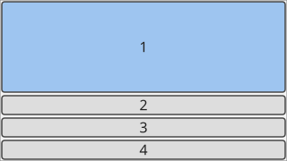

* [ ] *Binary Column* (`BinaryColumn`): one full-width column where each
  window is half the height of the one above it, except the last two,
  which share the rest. Adding or removing a window only resizes the last
  pair.
+
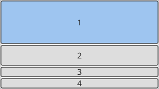

* [ ] *Split Grid* (`GridVariants.SplitGrid`): two grids, the master
  windows (here two) in a grid on top and the rest in a second grid below,
  with a resizable split between them and an adjustable master count.
+
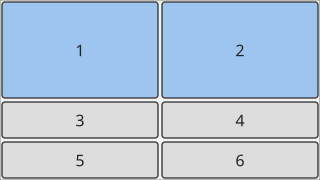

* [ ] *Mosaic* (`Mosaic`, `MosaicAlt`): windows are packed into rows and
  columns according to a per-window size weight, so the important windows
  get more area without a fixed master slot; keys grow or shrink the
  focused window's weight.
+
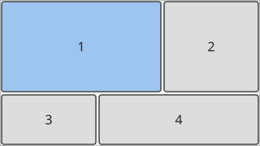

* [ ] *Zoom Row* (`ZoomRow`): all windows side by side in one row; the
  focused one can be zoomed to a larger share of the width (or to the
  whole row) and back.
+
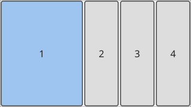

* [ ] *Sub-layouts* (`SubLayouts`, `Groups.Wmii`): windows grouped into
  slots of the outer layout, each group with its own inner layout,
  typically tabs: here window `1` is the master and windows `2`–`4` share
  the stack slot as a tabbed group. wmii/i3-style containers.
+
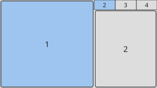

* [ ] *Magnifier* (`Magnifier`): a modifier for any layout that enlarges
  the focused window (e.g. 1.5×) over its neighbours, keeping it on
  screen; here over `Grid`. Handy for grids of many small windows.
+
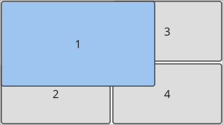

* [ ] *Circle* (`Circle`, `CircleEx`): the master large in the centre,
  the other windows smaller around it on a circle (partly covered by
  it). Rotating the stack cycles windows into the centre.
+
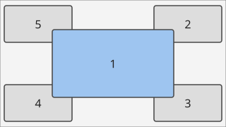

* [ ] *Cross* (`Cross`): the focused window in the centre and its
  neighbours in the stack peeking in from the four edges. Focusing the
  next window rotates them through the centre.
+
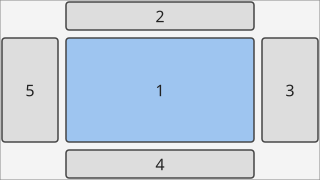

* [ ] *Roledex* (`Roledex`): windows cascaded diagonally like the cards of
  a Rolodex, the focused one in front and the others offset behind it.
+
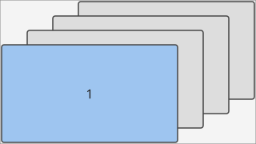

== Beyond xmonad

* [ ] Urgency without X11: highlight a workspace tag while one of its tray
  items needs attention (river has no urgency event yet), and urgent tabs.
* [ ] More bar modules over the tray's D-Bus connection: volume, MPRIS
  now-playing, network status, notification count; plus CPU and memory.
* [ ] Show config errors in the bar for a few seconds after a failed
  reload instead of only logging them.
* [ ] Window swallowing: a GUI app started from a terminal takes the
  terminal's place until it exits.
* [ ] Fractional scale for the WM-drawn surfaces (integer `wl_output`
  scale only today).

== Other open items

* [ ] Bar position/width options (xmobarrc's `TopW L 90`: top, left, 90%
  width); the bar spans its output today.
* [ ] Volume / brightness keys in the default bindings.
* [ ] Honour `maximize_requested` / `minimize_requested` (ignored, as in
  xmonad).
* [ ] Java apps: set `_JAVA_AWT_WM_NONREPARENTING=1` in the session
  environment (the Wayland/Xwayland replacement for `setWMName "LG3D"`).
* [ ] Tests for `remove_current_workspace`'s multi-monitor reassignment
  edge cases.

== Not planned

* A built-in notification daemon: mako and others already do it well.
* A window overview with live thumbnails: river's window-management
  protocol does not give oxmonad window contents.
* A window menu (`show_window_menu_requested`).
